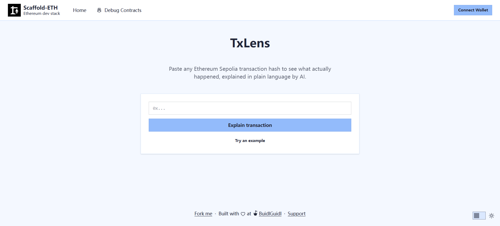

# TxLens

An AI-powered Ethereum transaction explainer. Paste a transaction hash and get
on-chain details plus a plain-language explanation and risk hints.

**[Live Demo](https://txlens-opal.vercel.app)**



## Why

Block explorers show raw data: long hex addresses, gas numbers, raw input data.
Most people cannot tell what a transaction actually did.

TxLens turns a transaction into a human-readable summary, and flags things worth
paying attention to.

## Features

- Fetch transaction + receipt from an Ethereum RPC
- Show from / to / value / nonce / status / gas used
- Generate a plain-language explanation with an LLM
- Risk hints (e.g. self-transfers, plain transfers vs contract calls)
- One-click example transaction for quick testing


## How it works

1. The client fetches `tx` and `receipt` with **viem**
2. A slim, BigInt-safe payload is POSTed to `/api/explain`
3. The API route calls the LLM with a structured prompt (API key stays server-side)
4. The explanation is rendered next to the raw on-chain data

## Tech stack

| Layer | Tech |
|---|---|
| Framework | Next.js 16 (App Router) |
| UI | React 19, Tailwind CSS, daisyUI |
| Chain access | viem |
| Wallets | wagmi, RainbowKit |
| LLM | DeepSeek (OpenAI-compatible API) |
| Deploy | Vercel |

## Run locally

```bash
git clone https://github.com/yah15660532032-wq/txlens.git
cd txlens
yarn install
```

Create `packages/nextjs/.env.local`:

```env
LLM_API_KEY=your_key
LLM_BASE_URL=https://api.deepseek.com
LLM_MODEL=deepseek-chat
```

```bash
cd packages/nextjs
yarn dev
```

Open http://localhost:3000

## Project structure

```
packages/
  nextjs/
    app/
      page.tsx            # redirects to /tx
      tx/page.tsx         # main UI
      api/explain/route.ts # LLM proxy (server-side key)
  hardhat/                # Scaffold-ETH contracts (from template)
```

## Notes and trade-offs

- Used **viem + a public RPC** instead of the Etherscan API: no key needed and
  no rate-limit issues for single-transaction lookups
- The LLM key is kept in a Next.js route handler and never shipped to the browser
- BigInt fields must be stringified before `JSON.stringify` — otherwise it throws
- The prompt explicitly forbids the model from inventing data it cannot see

## Known limitations

- Sepolia only for now
- Contract method names are not decoded yet (raw `input` is shown to the model)
- Explanation is generated in Chinese

## License

MIT